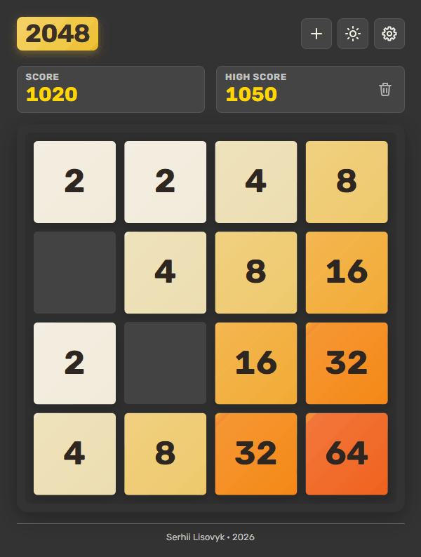

# 2048 Game

🎮 Responsive 2048 browser game built with vanilla JavaScript, modular CSS, and Webpack.

**[▶ Play the demo](https://2048-xi-three.vercel.app/)**



The classic 2048 puzzle as a compact static web game, written without a UI framework. The code is split into small object-oriented layers: a model with the rules, views, input, storage and controllers. It keeps production habits from larger projects: a Webpack build, size budgets, CI, linting hooks, and accessibility.

## ✨ Features

- Three board sizes (3×3, 4×4, 5×5), each with its own high score and a reset for it
- A win target for each board size (on 4×4: 1024, 2048 or 4096), saved with the game
- Animated moves: tiles slide, merge and pop in; a `+N` score pop and a `New record!` badge
- Light and dark themes that follow the system until you choose, with a circular reveal and no flash on load
- The game in progress is saved and restored after a reload
- All-time statistics (games played, wins, best score, best tile) with a reset
- Win and game-over dialogs with a game summary, and a confirmation before progress or records are lost
- A layout that fits any screen, a phone in landscape included, clear of notches
- Accessible: screen reader names and announcements, focus rings, 44px targets, reduced motion

## 🎮 Controls

| Action                                       | Keyboard                                     | Touch                                 |
| -------------------------------------------- | -------------------------------------------- | ------------------------------------- |
| Move the tiles                               | Arrow keys or WASD                           | Swipe anywhere on the page            |
| New game, switch theme, open settings        | Tab to a toolbar button, then Enter or Space | Tap a toolbar button                  |
| Close settings, cancel, continue after a win | Escape                                       | Tap Close, Cancel or Continue playing |

## 🧰 Tech Stack

- HTML
- CSS
- JavaScript
- Webpack 5
- Lightning CSS
- Terser
- ESLint
- Prettier
- Husky
- lint-staged
- size-limit
- GitHub Actions
- Vercel
- Yarn

## 📁 Project Structure

```text
src/
  index.html             Page markup, metadata and the four dialogs
  favicon.svg            SVG favicon
  fonts/                 Self-hosted Rubik (Latin woff2)
  scripts/
    main.js              Composition root: finds the DOM, creates and wires the objects
    constants.js         Board sizes, win tiles, timings, storage keys, settings table
    themeHead.js         Plain script inlined into <head>: sets the theme before the first paint
    game/                Model: Board, Game, Settings, Statistics (rules and values, no DOM)
    ui/                  Views: grid, score, dialogs, settings, theme switch, footer
    input/               Keyboard and swipe input
    storage/             Safe localStorage wrapper
    controllers/         Use cases and flow state: game, high score, saved game, settings, statistics, theme
  styles/
    main.css             CSS entry, imports the rest
    theme.css            Scales and every UI colour for both themes, the theme reveal
    base.css             Font face, reset, page base, focus ring
    layout.css           Page layout, the short landscape layout, footer
    header.css           Header: logo, score boxes, score pop, record badge
    board.css            Board, cells, tiles and their animation classes
    tiles.css            Tile palette, one rule per tile value
    overlays.css         Dialogs: win, game over, confirmation, settings
    controls.css         Buttons, segmented control, toolbar, icon buttons
    animations.css       Every @keyframes
    motion.css           Reduced-motion overrides
public/                  Files with an unhashed URL, copied as they are: link preview image, robots.txt, llms.txt
webpack/                 Webpack config in parts: paths, browser targets, loaders, plugins
assets/                  The gameplay GIF shown above
ai/                      Agent docs: repo map, rules, decisions, skills, prompts, plans
```

## 🚀 Scripts

Install dependencies, which also installs the pre-commit hook (needs Node.js 20.19+, 22.13+ or 24+, and Yarn 1):

```bash
yarn install
```

Run the development server at <http://localhost:8080>:

```bash
yarn dev
```

Build the production version into `dist/`:

```bash
yarn build
```

Preview the production build locally (run `yarn build` first):

```bash
yarn preview
```

Lint the code (`yarn lint:fix` also fixes what it can):

```bash
yarn lint
```

Format the code with Prettier (`yarn format:check` only checks):

```bash
yarn format
```

Check the bundle sizes against their budgets (run `yarn build` first):

```bash
yarn size
```

## 🔄 CI

Every push runs lint, the format check, the build and the size budgets from [`.size-limit.json`](.size-limit.json) on GitHub Actions.
The pre-commit hook runs ESLint and Prettier on the staged files through Husky and lint-staged.
`main` is deployed to Vercel, and other branches get preview deployments.

## 🧱 Architecture Notes

- Object-oriented layers (model, views, input, storage, controllers) are created and wired in `main.js` ([rules](ai/rules/oop.md))
- Tiles are elements over a background grid, animated from the move result the model reports ([decision](ai/decisions/2026-10-10-tiles-over-the-grid.md))
- Modals are native `<dialog>` elements, with one shared confirmation that answers a Promise ([decision](ai/decisions/2026-10-10-native-dialog.md))
- Colours are tokens, and the theme is `data-theme`, set by a head script before the first paint ([decision](ai/decisions/2026-10-10-theme-tokens-and-head-script.md))
- No UI framework and no automated tests, by design ([decisions](ai/decisions/README.md))

## 🤖 AI Workflow

The game is built and maintained by AI agents (Claude Code) under the author's review. Everything they need lives in the repo, written for any agent rather than one tool:

| Part                                      | What it gives an agent                                                    |
| ----------------------------------------- | ------------------------------------------------------------------------- |
| [`AGENTS.md`](AGENTS.md)                  | The entry point: project defaults and the rules that never bend           |
| [`ai/map.md`](ai/map.md)                  | Where every file, class and storage key lives                             |
| [`ai/rules/`](ai/rules)                   | How to write the code and the docs, and the Definition of Done            |
| [`ai/decisions/`](ai/decisions/README.md) | Why things are the way they are, so nothing settled gets "fixed" back     |
| [`ai/skills/`](ai/skills/README.md)       | Playbooks: adding a feature, self-review, remaking the link preview       |
| [`ai/prompts/`](ai/prompts/README.md)     | Session prompts: one task, or an orchestrator running several in parallel |
| [`ai/superpowers/`](ai/superpowers)       | The plan (and spec) of every past task                                    |

Every change follows [one workflow](ai/workflow.md): a Linear issue → a plan → the code on its own branch → checks and a run in the browser → self-review → the author's approval → a local merge into `main`.
